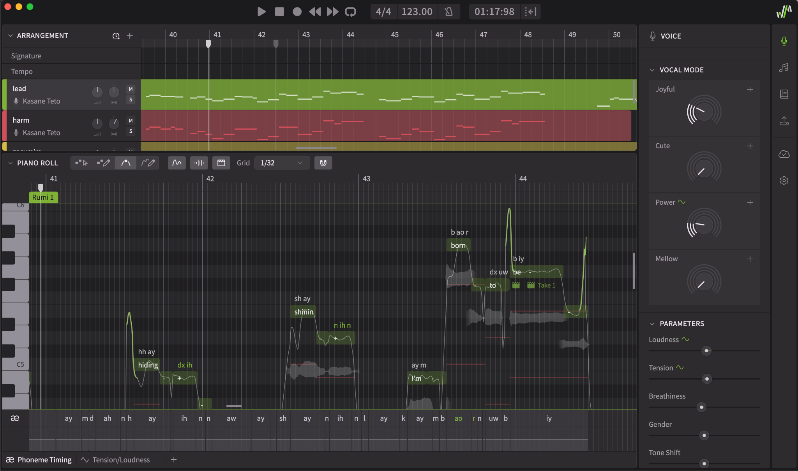
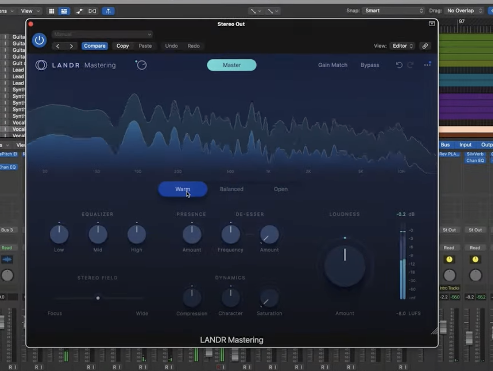

<figure class="figure-hero">
  
</figure>

Over lunch at Timbre+ food court in Singapore’s tech district, I was explaining my music production using AI-powered vocal synthesis to coworkers. Using tools such as [Synthesizer V](https://dreamtonics.com/synthesizerv/) with ethically-sourced voicebanks, I tuned vocals as I would play a piano, maintaining full creative control over my piece.

A senior developer interrupted skeptically: *“Okay, aren’t you just prompt engineering?”*

Musicians are egotistical creatures. They take pride in their countless hours of composition, arranging, and mixing. The worst dismissal is being accused of taking shortcuts. Yet, I was brushed off as yet another wannabe who conjured “music” with AI, instead of learning the basics like a “proper” musician.

Today, advancements in AI have birthed innovations in the music scene. AI-powered vocal synthesis software such as Synthesizer V is one of them. Using deep-learning algorithms to analyse and concatenate recordings from voice providers, they produce natural-sounding vocal performances based on user-composed melodies and lyrics. To solo bedroom producers such as myself, it is an invaluable instrument to prototype vocal melody ideas with vast levels of customisability.

<figure class="figure-lg">
  
  <figcaption>With numerous vocal parameters, using vocal synthesis software like Synthesizer V is not nearly as simple as feeding text prompts to a large-language model (LLM).</figcaption>
</figure>

However, tools such as these (and the musicians who use them) have faced unprecedented hostility from consumers and musicians alike.

## Why the Hate?

Over the years, public sentiment on Artificial Intelligence (AI) in music has soured. Only 28% of respondents held a “positive attitude towards AI in music”, down from 43% two years prior, a 2025 survey by Finnish performance rights organisation [Teosto [1]](https://www.teosto.fi/en/teosto-ai-survey-2025/) found. Additionally, an [American Psychological Association article [2]](https://doi.org/10.1037/xap0000447) on 295 participants found support for *AI composer bias*, where less-liked pieces were attributed to have been composed by an AI, and that the presence of an AI label negatively affected the perceived quality of the music.

The backlash against AI in music has become a moral panic that obscures the ethical distinctions of each AI system. Not all AI tools are created equal. Thus, treating them as such does a disservice to both the innovations that have respected the creative process, and the musicians who have used them to elevate their craft.

## The Consent Problem

One of the fundamental ethical violations committed by many AI systems is the unconsented use of creative content for training. Scraping copyrighted works off the Internet on an unprecedented scale, they are effectively laundering the creative labour of millions of artists. While generative AI music creation platforms like [Suno are generating eight-digit figures in annual revenue [3]](https://www.musicbusinessworldwide.com/suno-is-generating-more-than-100m-in-annual-revenue-and-is-in-talks-to-raise-more-money-at-a-2b-valuation/), artists receive little to no compensation when their work is consumed to generate competing content.

However, not all AI music tools operate in this unscrupulous manner. In the domain of AI-powered vocal synthesizers, there exists consent-based models that ensure that the rights of voice providers — such as identity, career, and safety — are protected at all times.

[Eclipsed Sounds](https://www.eclipsedsounds.com/), an American business supplying vocal synthesizers to Synthesizer V, ensures that contracted voice providers have clearly-defined royalties and payment structures, before development even begins. Voice providers are involved in every step of the project, from vocal design all the way to the name and design of their virtual characters. The licenses for their vocal synthesizers also specifically prohibit users from assuming the identity of their voice providers, protecting them against deepfakes.

This consent-based model respects artist autonomy and transforms the relationship between AI companies and artists from exploitative to collaborative. Rather than harvesting artistic labour, Eclipsed Sounds humanises the artist and ensures fair compensation.

<figure class="figure-sm">
  
  <figcaption>Professional singer-songwriter Emma Rowley holding a copy of SOLARIA, a vocal synthesizer she was the voice provider of. Credit: Eclipsed Sounds</figcaption>
</figure>

## The Authorship Question

Creativity — as defined by [German philosopher Immanuel Kant [4]](https://plato.stanford.edu/entries/creativity/) as the ability to produce original and exemplary works — is a virtue deeply embedded in the human condition, shaped by personal experience and emotional depth. For any self-respecting creator, maintaining the integrity of the human creative process is non-negotiable.

However, generative AI that produces entire pieces from text prompts detaches human decision-making from the creative chain. The user becomes a commissioner rather than a creator, surrendering their artistic freedoms to an AI that simply regurgitates a hodgepodge of musical elements from its training data. Creativity is then reduced to a series of choice words to instruct a machine to perform algorithmic reconstruction.

Assistive AI tools fundamentally function differently. [LANDR’s AI-powered music mastering plugin](https://www.landr.com/) takes in a finished mix and applies technical corrections such adjusting equalization levels, compression ratios, and removing harsh noises. What once required hours of tediously adjusting knobs could now be shortened to mere minutes, allowing musicians to spend proportionally more time on composing, arranging, and sound design — the meat of their work.

<figure class="figure-md">
  
  <figcaption>LANDR’s audio mastering plugin delivers “fast, reliable AI mastering results”, without depriving the creator of the ability to make changes to audio parameters themselves. Credit: LANDR</figcaption>
</figure>

The tool does not attempt to modify any aspect of the input work, allowing the user to manually fine-tune these parameters themselves. This distinction matters because the artist will still be in full control over their work, with the AI only serving to handle technical refinements.

By requiring sustained human input, assistive AI tools preserve human authorship of the piece, respecting the artistic decision-making process.

## Composing a Fairer Future

Music creation has always evolved alongside technology. The ‘60s introduced synthesizers, allowing musicians to create sounds impossible with traditional acoustic instruments. Digital audio workstations placed studio-level production capabilities onto the laps of individuals in the 1990s. Today, advancements in AI have disrupted the music industry once again.

Regrettably, we live in a world with countless actors who flood streaming platforms with AI-generated “slop”. However, we should recognise that there are diamonds in the rough — the companies and musicians who champion artist autonomy and human authorship. When leveraged responsibly, AI tools can democratise music production, and allow musicians to focus on the truly essential elements of their craft.

We don’t all need to love AI in music, but we should be precise in our criticisms towards them. We should not let the overzealous witch hunt create rifts within the music community, damaging the fundamental musician-audience dynamic that has flourished for centuries.

---

### Reflection: As a Computer Science Graduate

> As professionals more predisposed to AI, Computer Science graduates such as myself should be more deliberate in its use in creative domains. As users of coding agents and other automation tools, it is easy for us to naively extend this “techbro” mentality to similar agents for the arts. However, in an age of increasing automation and capabilities that facilitate mechanical reproduction, we should remain empathetic to the value of human expression by upholding the rights of artists. While we may not be creators ourselves, we can support them by backing tools that ensure fair compensation and maintain human authorship.

---

## References

1. Vappu Aura, [“Survey: AI is already used commonly in the Finnish music industry, but concerns are growing,”](https://www.teosto.fi/en/teosto-ai-survey-2025/) *Teosto*, Oct. 19, 2025.
2. D. B. Shank, C. Stefanik, C. Stuhlsatz, K. Kacirek, and A. M. Belfi, [“AI composer bias: Listeners like music less when they think it was composed by an AI,”](https://doi.org/10.1037/xap0000447) *Journal of Experimental Psychology: Applied*, vol. 29, no. 3, pp. 676–692, Sep. 2023.
3. M. Dalugdug, [“Suno is generating more than $100m in annual revenue – and is in talks to raise more money at a $2B valuation,”](https://www.musicbusinessworldwide.com/suno-is-generating-more-than-100m-in-annual-revenue-and-is-in-talks-to-raise-more-money-at-a-2b-valuation/) *Music Business Worldwide*, Nov. 9, 2025.
4. E. S. Paul and D. Stokes, [“Creativity,”](https://plato.stanford.edu/entries/creativity/) *Stanford Encyclopedia of Philosophy*, Nov. 9, 2025.
